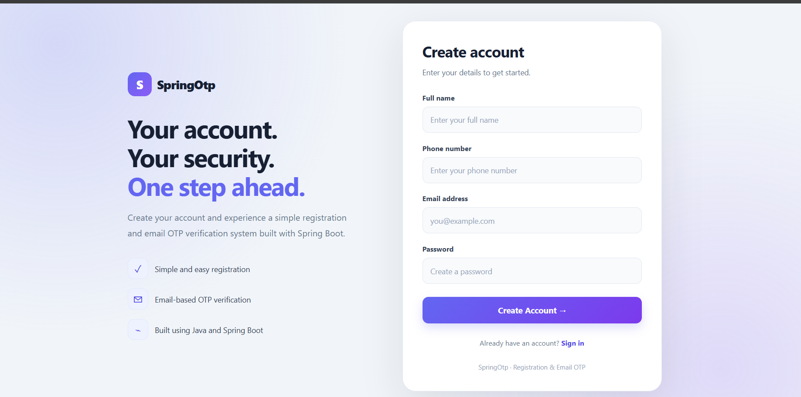
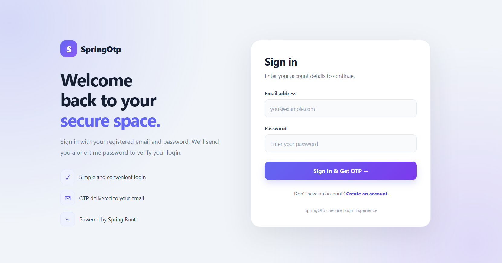
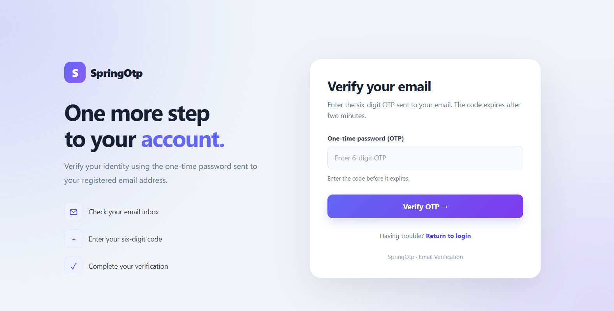
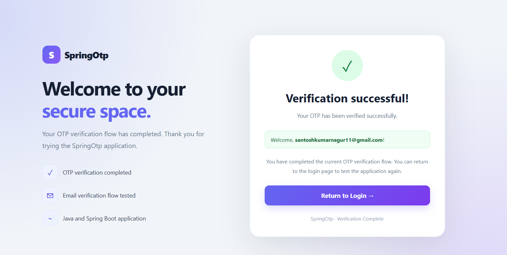

# 🔐 SpringOtp — Email OTP Authentication System

A secure, email-based One-Time Password (OTP) authentication application built with **Java, Spring Boot, Spring Data JPA, MySQL, Thymeleaf, and Spring Mail**.

SpringOtp provides a registration and login workflow with email OTP verification, password hashing, OTP expiration, and session-based access to a protected home page.

## 📌 Table of Contents

- [Overview](#-overview)
- [Features](#-features)
- [Application Screenshots](#-application-screenshots)
- [Technology Stack](#-technology-stack)
- [Authentication Workflow](#-authentication-workflow)
- [Project Structure](#-project-structure)
- [Prerequisites](#-prerequisites)
- [Installation and Setup](#-installation-and-setup)
- [Environment Configuration](#-environment-configuration)
- [Running the Application](#-running-the-application)
- [Security Considerations](#-security-considerations)
- [Future Enhancements](#-future-enhancements)

## 🚀 Overview

SpringOtp demonstrates an email OTP authentication workflow using the Spring Boot ecosystem. Users can register, log in, verify an OTP sent to their email, and access a session-protected page.

The project focuses on backend development, database integration, email communication, authentication, and connecting server-side Java code with a Thymeleaf-based user interface.

## ✨ Features

- **User Registration:** Register users with account details.
- **User Login:** Authenticate users using their registered credentials.
- **Email OTP Verification:** Generate and send a six-digit OTP through Gmail SMTP.
- **OTP Expiration:** OTP expires after two minutes.
- **Attempt Limiting:** Delete the OTP after five incorrect verification attempts.
- **Latest OTP Validation:** A newly generated OTP invalidates the previous OTP.
- **Password Hashing:** Store passwords using BCrypt rather than plain text.
- **Session-Based Authentication:** Restrict access to the home page to authenticated users.
- **Logout:** Invalidate the current session when logging out.
- **Responsive User Interface:** HTML, CSS, Thymeleaf templates, and responsive styling.

## 🖼️ Application Screenshots

Screenshots help visitors understand the application before installing it.

<!-- Replace the placeholder filenames with your actual screenshots. -->

### Registration Page



### Login Page



### OTP Verification Page



### Home Page



> **Note:** Add your actual screenshots to the `screenshots` folder using the filenames shown above. Until you add them, these images will not display.

## 🛠️ Technology Stack

| Technology | Purpose |
|---|---|
| Java | Application programming language |
| Spring Boot | Application framework |
| Spring MVC | Web requests and controller handling |
| Spring Data JPA | Database access |
| Hibernate | JPA implementation and ORM |
| MySQL | Relational database |
| Spring Mail | Sending OTP emails |
| Spring Security Crypto / BCrypt | Password hashing |
| Thymeleaf | Server-side HTML rendering |
| HTML5 | Page structure |
| CSS3 | Styling and responsive design |
| Maven | Dependency management and build |
| Git and GitHub | Version control and source hosting |

## 🔄 Authentication Workflow

1. A new user registers through the registration page.
2. The application stores the user's password as a BCrypt hash.
3. The user enters their login credentials.
4. The application generates a six-digit OTP and sends it to the registered email address.
5. The user enters the OTP on the verification page.
6. The OTP is checked for validity, expiration, and incorrect-attempt limits.
7. After successful verification, the user can access the protected home page.
8. Logging out invalidates the authenticated session.

## 📁 Project Structure

```text
SpringOtp/
├── src/
│   ├── main/
│   │   ├── java/
│   │   │   └── com/kodnest/auth/
│   │   │       ├── Controller/
│   │   │       │   └── UserController.java
│   │   │       ├── Entity/
│   │   │       │   ├── User.java
│   │   │       │   └── UserOTP.java
│   │   │       ├── Repository/
│   │   │       │   ├── UserRepository.java
│   │   │       │   └── UserOTPRepository.java
│   │   │       ├── Service/
│   │   │       │   └── UserService.java
│   │   │       └── SpringOtpApplication.java
│   │   └── resources/
│   │       ├── static/
│   │       │   └── style.css
│   │       ├── templates/
│   │       │   ├── index.html
│   │       │   ├── login.html
│   │       │   ├── verifyotp.html
│   │       │   ├── home.html
│   │       │   └── Loginfail.html
│   │       └── application.properties
│   └── test/
├── screenshots/
├── .gitignore
├── mvnw
├── mvnw.cmd
├── pom.xml
└── README.md
```

## 📋 Prerequisites

Install the following before running the application:

- Java JDK compatible with the project's Spring Boot version
- Maven, or use the included Maven Wrapper
- MySQL Server
- A Gmail account with a Google App Password
- Git (optional, for cloning the repository)

## ⚙️ Installation and Setup

### 1. Clone the repository

```bash
git clone https://github.com/Santoshkumarnagur/SpringOtp.git
cd SpringOtp
```

### 2. Create the MySQL database

Open MySQL Workbench or your MySQL client and execute:

```sql
CREATE DATABASE springotpdb;
```

### 3. Configure environment variables

The application uses environment variables for database and email credentials. Configure the following variables in your terminal or IDE run configuration.

| Variable | Description |
|---|---|
| `DB_USERNAME` | MySQL username |
| `DB_PASSWORD` | MySQL password |
| `MAIL_USERNAME` | Gmail address used to send OTP emails |
| `MAIL_APP_PASSWORD` | Google App Password for that Gmail account |

Do not commit real passwords, email app passwords, or other secrets to GitHub.

### 4. Verify application configuration

The `src/main/resources/application.properties` file should use environment-variable placeholders rather than hardcoded credentials.

```properties
spring.application.name=SpringOtp

spring.datasource.url=jdbc:mysql://localhost:3306/springotpdb
spring.datasource.username=${DB_USERNAME:root}
spring.datasource.password=${DB_PASSWORD:CHANGE_ME}

spring.mail.host=smtp.gmail.com
spring.mail.port=587
spring.mail.username=${MAIL_USERNAME:CHANGE_ME}
spring.mail.password=${MAIL_APP_PASSWORD:CHANGE_ME}

spring.mail.properties.mail.smtp.auth=true
spring.mail.properties.mail.smtp.starttls.enable=true
```

The fallback values are placeholders, not actual credentials. Configure the environment variables before starting the application.

### 5. Run the application

**Windows Command Prompt:**

```cmd
mvnw.cmd spring-boot:run
```

Alternatively, open the project in Spring Tool Suite (STS), locate `SpringOtpApplication.java`, and run it as a Spring Boot App.

### 6. Open the application

Once the application starts successfully, open:

```text
http://localhost:8080
```

If your controller maps the registration page to a different route, use the corresponding route configured in the application.

## 🔒 Security Considerations

- Passwords are hashed with BCrypt.
- Database and mail credentials should be supplied through environment variables.
- OTPs have a two-minute expiration period.
- OTP verification is limited to five incorrect attempts.
- Generating a new OTP invalidates the previous OTP.
- Authenticated pages use session-based access control.
- Never publish real credentials, private user information, or production database details in screenshots or source code.

**Production note:** Before deploying publicly, review HTTPS, secure cookie settings, CSRF protection, rate limiting, OTP storage and handling, session management, and account recovery.

## 🚧 Future Enhancements

- Add automated tests for registration, login, and OTP verification.
- Add resend-OTP cooldown and rate limiting.
- Improve validation and error messages.
- Add account recovery and password reset.
- Add email verification during registration.
- Add structured logging and monitoring.
- Add Docker-based deployment.
- Deploy the application with managed database and email configuration.

## 👨‍💻 Author

**Santosh Kumar Nagur**

GitHub: [@Santoshkumarnagur](https://github.com/Santoshkumarnagur)

---

⭐ If you find this project useful, consider starring the repository.
